<!-- Banner autoral em assets/banner.svg (SVG animado) · cobrinha gerada pelo workflow .github/workflows/perfil.yml (branch output) -->

  

  Construo produtos de ponta a ponta: APIs em Django, interfaces em Next.js, tudo em Docker. 
  <a href="https://www.linkedin.com/in/luisdevhm">LinkedIn</a> · <a href="mailto:luisfelipeholanda12@gmail.com">e-mail</a>

<picture>
  <source media="(prefers-color-scheme: dark)" srcset="https://raw.githubusercontent.com/luis-hm/luis-hm/output/snake-dark.svg" />
  
</picture>
